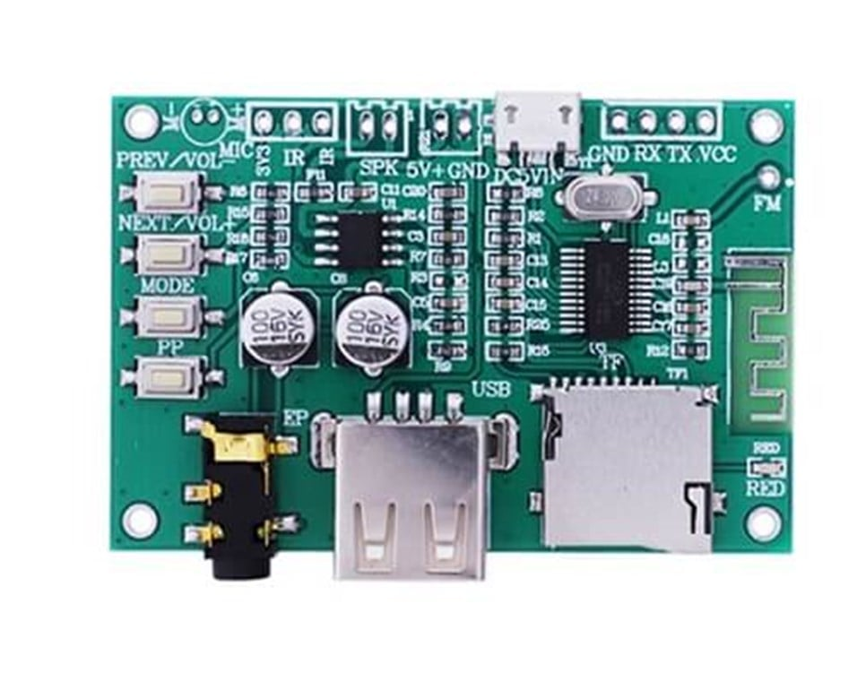

# MagicJL — AC692x / BT201 Özel Firmware Çalışması

> Küçük bir ses çipinin büyük bir kişiliği olabilir.

<p align="center">
  
</p>

<p align="center">
  
  
  
  
  
  
  
</p>

MagicJL, Jieli AC692x tabanlı bir **BT201** kart için hazırlanmış kişiselleştirilmiş bir firmware çalışmasıdır. Proje; standart Bluetooth hoparlör/oynatıcı arayüzünü daha anlaşılır, daha görsel ve daha eğlenceli bir deneyime dönüştürmeyi hedefler.

Bu çalışma, orijinal SDK’nin üzerine eklenen UI geliştirmelerini, ADKEY düzenlerini, Bluetooth durum ekranlarını ve gerçek-zamanlı ses görselleştiricisini içerir.

> [!NOTE]
> **Unofficial community firmware/customization project; vendor SDK and docs
> retain their owners’ terms.** MagicJL / OBM Team'e ait özgün katkılar
> [LICENSE-MAGICJL.md](LICENSE-MAGICJL.md) kapsamında MIT ile paylaşılır;
> bundled vendor SDK ve referans dokümanlar bu lisansın dışında kalır. Ayrıntı:
> [NOTICE.md](NOTICE.md).

## Hızlı Başlangıç

Bu depo, tam ve derlenebilir **MagicJL BT201 OLED SDK** ağacını içerir. Kullanıcı için patch, overlay veya elle dosya kopyalama gerekmez:

1. Geliştirme için bu depoyu doğrudan klonlayın veya ZIP olarak indirin. Hazır firmware için GitHub Releases sayfasındaki en yeni `.bfu` dosyasını kullanın.
2. `BT_201_AC692x_SDK_release_V2.6.3\apps\sdk.cbp` dosyasını Code::Blocks ile açın.
3. `SDK_flash` hedefi ile `Release` yapılandırmasını seçin.
4. Build yapın ve kartınıza uygun yöntemle firmware'i yükleyin.

Hazır flash dosyası yayınlanmışsa derleme yapmadan doğrudan Release asset'ini kullanabilirsiniz. Detaylı rehberler: [dokümantasyon dizini](docs/README.md).

## Depo Yapısı

```text
MagicJL-BT201/
├─ BT_201_AC692x_SDK_release_V2.6.3/  # Tam MagicJL SDK ağacı
├─ hardware/           # Arduino Nano flash dongle sketch'i
├─ docs/               # Kurulum, derleme, donanım, UI ve müzik rehberleri
├─ images/             # Ekran görüntüleri ve flash dongle şemaları
├─ README.md
└─ .gitignore
```

SDK içindeki `apps/obj/` ile `apps/download/post_build/flash/` altındaki üretilmiş firmware dosyaları Git'e eklenmez; `.gitignore` bunları dışarıda bırakır. GitHub, kaynak ağacının ZIP paketini otomatik sunar; hazır `.bfu` firmware dosyaları ayrıca Releases'a yüklenir.

## Öne Çıkanlar

- Türkçeleştirilmiş LCD metinleri ve menüler
- Animasyonlu açılış karşılama ekranı
- Yükleme ekranında dönen nokta animasyonu
- Özel Bluetooth bağlantı ekranları
- Bluetooth bağlantı, müzik ve çağrı durum ikonları
- Bağlı cihaz adı gösterimi
- AVRCP üzerinden şarkı adı ve sanatçı bilgisi
- Pikselle çizilen, akıcı AVRCP marquee yazısı
- Gerçek PCM verisiyle çalışan 10 bantlı FFT spektrum analizörü
- Peak-hold göstergeleri ve ses seviyesine bağlı bar limitleme
- USB/SD müzik modunda görselleştirici
- Bluetooth müzik modunda görselleştirici
- Tuşla açılan, müzik çalmayı kesmeyen sistem bilgi ekranı
- Uzun basılı Mode ile EQ preset değiştirme
- ADKEY ile ileri/geri sarma, ses ve oynatma kontrolleri
- Dosya silme için LCD onay ekranı

## Görünüm ve Arayüz

### Açılış

Cihaz açılırken `Hoşgeldiniz!` metni karakter karakter gelir. Ardından `By OBM(BR4)` kredisi ekrana kayarak girer ve normal görev ekranına geçilir.

### Bluetooth durumu

Bluetooth modunda cihazın durumuna göre özel ekranlar gösterilir:

| Durum | Ekran davranışı |
| --- | --- |
| Bağlı değil | Dönen noktalı bağlantı halkası ve bağlantı bekleme ekranı |
| Bağlanıyor | Onay işareti ve `BT Bağlandı` durumu |
| Müzik çalıyor | Müzik ikonu, cihaz/AVRCP bilgisi ve spektrum ekranı |
| Çağrı | Telefon ikonu ve çağrı durumu |

### AVRCP Now Playing

Telefon AVRCP metadata gönderiyorsa şarkı adı ve sanatçı alınır. Bilgi, Bluetooth spektrum ekranının üstünde küçük piksel yazı tipiyle sağdan sola akar.

- Başlık ve sanatçı sırayla gösterilir.
- Metin 48 karaktere kadar saklanır.
- Telefon metadata göndermiyorsa bağlı cihaz adı kullanılır.
- Özel marquee, SDK’nin standart kayan yazı kontrolünden bağımsızdır; bu sayede spektrum yenilenirken bozulmaz.

## Spektrum Analizörü

Bu cihazda donanımsal FFT bulunmadığı için analizör tamamen yazılımla çalışır.

1. PCM ses verisi, DAC’ye gitmeden hemen önce alınır.
2. Düşük yük için her dördüncü örnek halka tamponuna kaydedilir.
3. LCD güncellemesinde 256 noktalı, sabit-nokta Q15 radix-2 FFT hesaplanır.
4. Hann penceresi, frekans sızıntısını azaltır.
5. FFT sonuçları 10 görsel frekans bandına dönüştürülür.
6. Her bant için yumuşatma, peak-hold ve otomatik seviye dengeleme uygulanır.

FFT, gerçek-zamanlı DAC/oynatma kesmesinde değil, yalnızca UI yenilenirken çalışır. Bu sayede Bluetooth ve yerel müzik oynatma stabil kalır.

## Yerel Müzik / MP3 Oynatıcı

MagicJL'in yerel oynatma modu USB disk veya etkinleştirilmiş SD depolamadaki müzik dosyaları için kullanılır. SDK'nin müzik görevi; dosya tarama, klasör yapısı, decoder, devam noktası ve ekran durumunu birlikte yönetir.

### Kullanılabilen işlevler

- Oynat / duraklat; sonraki ve önceki dosya
- Önceki / sonraki klasör
- Basılı tuşla ileri sarma ve geri sarma; tuş bırakılınca FF/FR ikonunun temizlenmesi
- Dosya adı, klasör adı, dosya numarası ve oynatma süresi gösterimi
- EQ preset göstergesi ve uzun Mode basışıyla EQ değiştirme
- Tekrar modları: tümü, tek parça, rastgele ve klasör tabanlı tekrar
- Silme isteğinde iki aşamalı LCD onayı; ilk basışta doğrudan silme yapılmaz
- Müzik çalarken hareketsizlikten sonra açılan PCM/FFT görselleştiricisi
- Herhangi bir tuşla görselleştiriciden normal müzik ekranına dönüş
- Decoder hata, cihaz çıkarılması ve dosya bulunamadı durumlarının UI bildirimi

### Yerel müzik tuşları

| Direnç | Kısa basış | Uzun / basılı tutma |
| --- | --- | --- |
| 100K | Silme isteği | Sistem bilgi ekranı |
| 33K | Tekrar modu değiştir | - |
| 24K | Önceki klasör | Geri sarma |
| 15K | Sonraki klasör | İleri sarma |
| 9.1K | Mod değiştir | EQ preset değiştir |
| 6.2K | Sonraki parça | Ses artır |
| 3K | Önceki parça | Ses azalt |
| 0R | Oynat / duraklat | Sessiz |

> Dosya silme fiziksel depolamayı değiştirir. Onay ekranı açıkken doğru tuşa basmadan silme yapılmamalıdır; test medyasıyla denemek en güvenli yaklaşımdır.

### İlgili kaynaklar

| Dosya | Görev |
| --- | --- |
| `apps/task_manager/task_music/task_music.c` | Yerel müzik mesajları, silme onayı, dosya/klasör işlemleri |
| `apps/task_manager/task_music/task_music_key.c` | Yerel müzik ADKEY eşlemesi |
| `apps/common/music_player/music_player.c` | Dosya oynatma ve silme altyapısı |
| `apps/common/music_player/music_decoder.c` | Decoder durumu, ileri/geri sarma ve oynatma zamanı |
| `apps/cpu/ui/lcd/lcd_disp.c` | Dosya adı, süre, EQ, tekrar, silme/sarma ikonları ve görselleştirici |

### Spektrum ayarı

Barların genel yüksekliği şu bloktan ayarlanabilir:

`BT_201_AC692x_SDK_release_V2.6.3/apps/cpu/ui/lcd/lcd_disp.c`

```c
height_limit = 16 + sound.vol.sys_vol_l;
if (height_limit > 48) {
    height_limit = 48;
}
```

- `16`: düşük ses seviyesindeki minimum hareket alanı
- `48`: üst metin alanına taşmadan ulaşılabilen maksimum bar yüksekliği

Bandlara özel görsel kazanç ise burada bulunur:

`BT_201_AC692x_SDK_release_V2.6.3/apps/cpu/audio/audio.c`

```c
static const u8 audio_visualizer_band_gain_pct[10] = {
    100, 100, 100, 100, 100, 110, 120, 130, 140, 150,
};
```

Soldaki değerler bas, sağdakiler tiz bölgesidir. Değeri artırmak yalnızca ekran barını büyütür; ses EQ’sunu değiştirmez.

## Sistem Bilgi Ekranı

**100K ADKEY tuşuna uzun basıldığında** çalışan mod kesilmeden bilgi ekranı açılır. Ekran otomatik olarak sayfalar arasında geçer ve sonunda önceki arayüze geri döner.

Gösterilen bilgiler:

- MagicJL
- Developed by OBM Team
- Developer / Maintainer: BarbaroR4
- Software: `MJL_4.8.26_V1.0_BT201`
- 192 MHz PI32V2 Blackfin
- 128 KB SRAM
- 512 KB Flash
- Easter egg: `AC692 UNLOCKED`

## Tuş Yapılandırması

Karttaki ADKEY direnç ağı proje için özelleştirilmiştir.

| Direnç | Genel işlev |
| --- | --- |
| 100K | Kısa basış: müzik modunda dosya silme; uzun basış: sistem bilgisi |
| 9.1K | Kısa basış: mod değiştir; uzun basış: EQ preset değiştir |
| 6.2K | Sonraki parça; basılı tut: ses artır |
| 3K | Önceki parça; basılı tut: ses azalt |
| 0R | Oynat / duraklat |
| 24K | Basılı tut: geri sarma |
| 15K | Basılı tut: ileri sarma |

> Tuş tablosu kullanılan karta göre değişebilir. Kendi direnç ağınız farklıysa ilgili `task_*_key.c` dosyalarındaki ADKEY tablolarını düzenleyin.

## Geliştirme Ortamı, SDK Kurulumu ve İlk Derleme

Bu SDK, klasik GCC/ARM toolchain ile derlenmez. AC692x ailesi için Jieli'nin **PI32V2 LTO toolchain**'i gerekir. Depodaki `DOC/AC692x_SDK_introduce.pdf` ve `DOC/AC692x_SDK_Tool description.pdf` bu akışın asıl kaynaklarıdır.

### 1. Gerekli kurulumlar

1. `codeblocks-16.01mingw-setup.exe` kurun.
2. Code::Blocks'u **bir kez açıp kapatın**. Toolchain kurucusu, bu sırada oluşturulan ayar dosyasına kayıt ekler.
3. AC692x ile uyumlu `jl_toolchain_pi32v2_lto` sürümünü kurun. Dokümanlardaki 2018 örneği `2.1.7` sürümüdür; elinizdeki SDK ile gelen veya Jieli tarafından verilen uygun sürümü kullanın.
4. Bazı Jieli toolchain dağıtımları makineye özel lisans gerektirir. Böyle bir paket kullanıyorsanız JL toolchain aracından `*.key` üretin ve sağlanan `*.lic` dosyasını içe aktarın.

> Bu proje lisanssız çalışan bir toolchain kurulumu ile de derlenmiştir. Lisans gereksinimi kullanılan toolchain paketi ve dağıtımına bağlıdır; lisans uyarısı görmüyorsanız ek işlem gerekmez.

### 2. Projeyi açma

Bu depo için ana proje dosyası genellikle aşağıdaki konumdadır:

```text
BT_201_AC692x_SDK_release_V2.6.3\apps\sdk.cbp
```

Dosyayı Code::Blocks ile açın. İlk derlemede derleyici seçilmemiş görünüyorsa proje adına sağ tıklayın:

```text
Build options -> Compiler settings
```

Buradan kurulu Jieli PI32V2 compiler profilini seçin.

### 3. Derleme

1. `SDK_flash` hedefini seçin.
2. `Release` yapılandırmasını seçin.
3. İlk kez veya kütüphane/linker ayarı değiştirdikten sonra **Build -> Rebuild** kullanın.
4. Sadece `.c` / `.h` değişikliği yaptıysanız normal **Build** yeterlidir.
5. Derleme sonrasında harita dosyası `apps/download/post_build/flash/Map.txt` altında güncellenir. RAM yerleşimi ve sembol izleme için faydalıdır.

Yükleme modundaki kart bağlıysa SDK/toolchain yapılandırmasına göre firmware otomatik indirilebilir; terminalde `download complete` mesajını kontrol edin. Aksi durumda oluşan `updata.bfu` dosyasını USB/SD güncelleme yöntemiyle veya Arduino Nano tabanlı flash dongle ile yükleyin.

## Firmware yükleme

MagicJL için iki normal yükleme yolu bulunur:

1. **USB disk veya SD kart:** Kartın Jieli update mekanizması destekliyorsa
   `updata.bfu` dosyasını kullanın.
2. **Arduino Nano dongle:** `.bfu` güncellemesi çalışmayan kartlarda, çipi
   açılış anında programlama moduna geçirip bilgisayara bağlayan özel dongle
   kullanılabilir.

> [!IMPORTANT]
> Bu iki yöntem farklıdır: USB/SD güncellemesi firmware'in kendi update
> işlevini kullanır; Nano dongle ise çipi doğrudan programlama moduna alır.
> Dongle bağlantısında D+ ve D- yönünü ölçmeden varsaymayın.

> [!TIP]
> Arduino Nano şemaları `images/flash/` altında yer alır. Pin eşlemesi,
> `0x16EF` boot anahtarı ve röleli/rölesiz devre notları için
> [firmware yükleme rehberine](docs/02-firmware-yukleme.md) bakın.

Stok firmware yedeği almak ve AC6925'i UBOOT modunda kurtarmak için
[yedekleme ve kurtarma rehberine](docs/08-yedekleme-kurtarma.md) bakın.

OLED'in PB0/PB1 bağlantısı ve kullanıcıların değiştirebileceği SDK özellik
anahtarları için [OLED ve SDK yapılandırması](docs/09-oled-ve-sdk-yapilandirma.md)
rehberine bakın.

## Vendor dokümanları
Üretici tarafından paylaşılamaz olarak işaretlendiği için repoda bulunmuyor.

### 4. SDK'yi güvenli kullanma

- `apps/`: uygulama kaynaklarıdır; günlük geliştirme için ana çalışma alanıdır.
- `apps/include/`: uygulama yapılandırmaları ve başlıklar; dikkatle düzenlenebilir.
- `include_lib/`: kütüphane ABI'siyle yakından ilişkilidir; yalnızca ne yaptığınızı biliyorsanız değiştirin.
- Kütüphane dosyası, linker ayarı veya board yapılandırması değiştiğinde Rebuild yapın.
- Her flash öncesi çalışan firmware ve resource paketinin yedeğini alın.

## Etkin SDK / Kart Yapılandırması

Aktif ayarlar `apps/include/sdk_cfg.h` içindedir. Bu BT201 yapılandırmasında görülen başlıca noktalar:

| Özellik | Durum / Not |
| --- | --- |
| 128×64 LCD | Etkin |
| Bluetooth Classic | Etkin |
| USB disk | Etkin |
| USB PC modu | Konfigürasyon dalına bağlı; hedef ayarını kontrol edin |
| FM | SDK'de etkin; kartta gerekli RF elemanları yoksa donanım eklenmeden kullanılamaz |
| AUX/Line-In | Kart donanımı desteklemiyorsa kapalı tutulmalı |
| Kayıt | SDK'de seçenekleri bulunur; kart/konfigürasyona bağlıdır |
| TWS | Varsayılan olarak kapalı |
| IR | PA4 için SDK tanımları mevcuttur; uygun 38 kHz alıcı ve eşleme gerekir |
| UART firmware update | Varsayılan konfigürasyonda kapalı |

### Dikkat

- Flashlama işlemi cihazı kullanılmaz hâle getirebilir. Önce çalışan firmware’in yedeğini alın.
- Bu proje belirli bir **BT201 / AC692x** donanımı için geliştirilmiştir; pinler, LCD kaynağı, tuş dirençleri ve kart şeması farklı cihazlarda farklı davranabilir.
- AUX/Line-In donanımı olmayan kartlarda bu modlar kullanılmamalıdır.
- IR alıcı devresi ve protokolü karttan karta değişebilir; test edilmeden doğrudan bağlanmamalıdır.

## Proje Yapısı

| Yol | Açıklama |
| --- | --- |
| `apps/cpu/ui/lcd/lcd_disp.c` | LCD ekranları, animasyonlar, sistem bilgisi, Bluetooth UI ve görselleştirici çizimi |
| `apps/cpu/audio/audio.c` | PCM örnek toplama, FFT ve spektrum band hesaplaması |
| `apps/cpu/ui/task_ui/bt_ui.c` | Bluetooth cihaz adı ile AVRCP title/artist saklama |
| `apps/btstack/user/bt_configs_user.c` | AVRCP metadata callback kaydı |
| `apps/task_manager/task_*/*_key.c` | Modlara göre ADKEY/IOKEY mesaj eşlemeleri |
| `apps/task_manager/task_common.c` | Her modda çalışan ortak sistem bilgi mesajı |
| `apps/include/sdk_cfg.h` | Çalışma modu, LCD, Bluetooth, USB, FM, kayıt ve board özellik anahtarları |
| `apps/download/post_build/flash/Map.txt` | Derleme sonrası sembol/RAM haritası |
| `DOC/` | SDK, toolchain, kullanıcı kılavuzu, AC692x datasheet ve referans şemaları |

## Donanım Özeti: AC692x ve AC6925A

`DOC/AC692X User Manual V1.0.pdf` ailesel AC692x genel özelliklerini; `DOC/AC692X_MCU_DOC+SCH/AC6925A Datasheet V1.0.pdf` ise AC6925A varyantına ait referans bilgilerini içerir. Dokümandaki aile seviyesi öne çıkanlar şunlardır:

- 32-bit DSP çekirdeği, 128 KB dahili SRAM ve 16 KB 4-way instruction cache kullanımı
- 64 kesme kaynağı ve dört seviyeli programlanabilir kesme önceliği
- Bluetooth V2.1 / V4.2 yetenekleri
- 16-bit stereo audio DAC ve MIC yükselteçli 12-bit stereo ADC
- USB Full-Speed OTG, UART0/1/2, SPI, SD host ve SPI flash arabirimleri
- 10-bit, 16 kanallı ADC; ADKEY ve gerilim algılama için kullanılabilir
- RTC, watchdog, PWM, GPIO wake-up, I²C, SPDIF giriş ve Audio Link gibi çevre birimleri
- Dahili FM alıcısı desteği (76-108 MHz; Bluetooth ile aynı anda kullanılamaz)

Bu özellikler **çip ailesinin kapasitesidir**. Bu projede kullanılabilir olması, kart üzerindeki komponentlere, pin eşlemesine ve `sdk_cfg.h` ayarlarına bağlıdır. Örneğin SDK FM'i desteklese bile BT201 kartında FM RF elemanları yoksa yalnızca yazılımı açmak radyo işlevi sağlamaz.

### PI32V2 notu

Bu firmware'in hedefi PI32V2 toolchain'idir. PI32V2; 16 genel amaçlı register, register çiftleriyle 64-bit işlem, sabit-nokta DSP aritmetiği ve paralel komut yürütmeye benzer özellikler sunan Jieli mimarisidir. MagicJL'in PCM tabanlı FFT görselleştiricisi bu yüzden float kullanmadan, Q15 sabit-nokta işlemlerle uygulanmıştır.

## Gelecek Fikirleri

- AVRCP süre/konum bilgisinden şarkı ilerleme çubuğu
- Seçilebilir spektrum temaları: mirror, waveform, VU meter
- Kayarak geçiş yapan sistem bilgi sayfaları
- Ekran parlaklığı ve görselleştirici stili için ayar menüsü
- Boşta kalınca saat / ekran koruyucu
- Gizli uzun-basma animasyonu: `BLACKFIN AWAKENS`

## Katkı ve Notlar

Bu proje cihazını kurcalamayı, öğrenmeyi ve sınırlarını zorlamayı sevenler içindir. Hata raporu, ekran görüntüsü, farklı kart uyarlaması ve fikirler her zaman değerlidir.

SDK’nin ve üçüncü taraf araçların kendi lisansları geçerlidir. Bu depoya proprietary SDK veya dağıtım izni olmayan ikili dosyalar eklemeden önce lisans koşullarını kontrol edin.

---

**MagicJL** · Developed by **OBM Team** · Maintained by **BarbaroR4**

`AC692 UNLOCKED`
