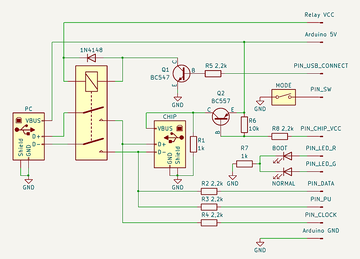
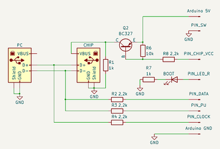

# Flashing the firmware

MagicJL is distributed as the complete BT201 SDK tree. There is no separate `apps/` copy script or patch step.

> [!WARNING]
> A wrong image, a power cut or bad wiring can leave the board unable to boot. **Back up the working firmware before you start.** See [Backup & recovery](08-backup-and-recovery.md).

## 1. USB stick or SD card update

The build produces `apps\download\post_build\flash\updata.bfu`. If your board supports it, give this file to JieLi's update mechanism on a USB stick or SD card.

- The file must be named `updata.bfu`.
- Which file system and insertion order work depends on the board's stock firmware.
- Do not remove power during the update.

> [!TIP]
> The `.bfu` attached to each [GitHub Release](https://github.com/OmfoBalkanMicroElectronics/MagicJieLi/releases) is a ready-to-flash image, so you don't need to build. Only use it on the same BT201/AC692x hardware layout.

## 2. Arduino Nano boot dongle

On some boards the `updata.bfu` method doesn't work. For those, MagicJL's reference BT201 can be programmed with a custom Arduino Nano dongle. It sends the `0x16EF` boot key over the USB data lines right after the chip powers up, which puts the chip into programming (UBOOT) mode.

The sequence:

1. Disconnect the chip's USB link to the PC.
2. Cut the chip's supply until it is close to 0 V.
3. Restore power.
4. Within the first few milliseconds, clock out `0x16EF` with **D+ = clock** and **D- = data**.
5. When the chip pulls D+ or D- low, connect the USB link to the PC.

> [!IMPORTANT]
> D+/D- wire colours differ between cables. In this project's dongle, **D- = white = Arduino D11** and **D+ = green = Arduino D10**. Check with a meter first. If the lines are swapped, the chip won't enter programming mode.

### Arduino Nano pinout

| Arduino Nano | Function |
| --- | --- |
| D11 | Chip D- / data |
| D10 | Chip D+ / clock |
| A5 | Chip power control (`0 = on`) |
| D2 | USB connection relay control |
| D3 | External pull-up control |
| A0 | Mode switch (`1 = normal`, `0 = boot`) |
| D5 | Red LED: boot / programming mode |
| D4 | Green LED: normal mode |

Sketch: [MagicJL_Boot_Dongle.ino](../hardware/arduino-nano-dongle/MagicJL_Boot_Dongle.ino)

### Schematics

#### With relays

  

This version switches both the target's power and the PC USB connection through relays. With the mode switch open you get normal mode (green LED). With it closed you get programming mode (red LED). On every mode change the sketch waits one second so the target's capacitors can discharge.

#### Without relays

  

In this simpler version the USB link is not switched by a relay. Connect the target, power the Arduino, and **plug the circuit into the PC the moment the red boot LED lights**. That timing is needed because the `0x16EF` key must arrive immediately after power-up.

Image files:

- `arduino-nano-releli.png`: relay version (switches USB and chip power)
- `arduino-nano-rolesiz.png`: simplified, relay-less version

Resistor values are not critical; anything from 2.2 kΩ to 10 kΩ works. The reference circuit uses 1 kΩ for R1. Power the relays separately, at their rated coil voltage.

> [!NOTE]
> This dongle approach has been tested with the **AC6905, AC6925 and AC6956**. If it fails, check three things first: that the power-off time is long enough, that the key is sent in the first milliseconds after power-up, and that D+/D- are the right way round. A cheap logic analyser helps a lot here.
